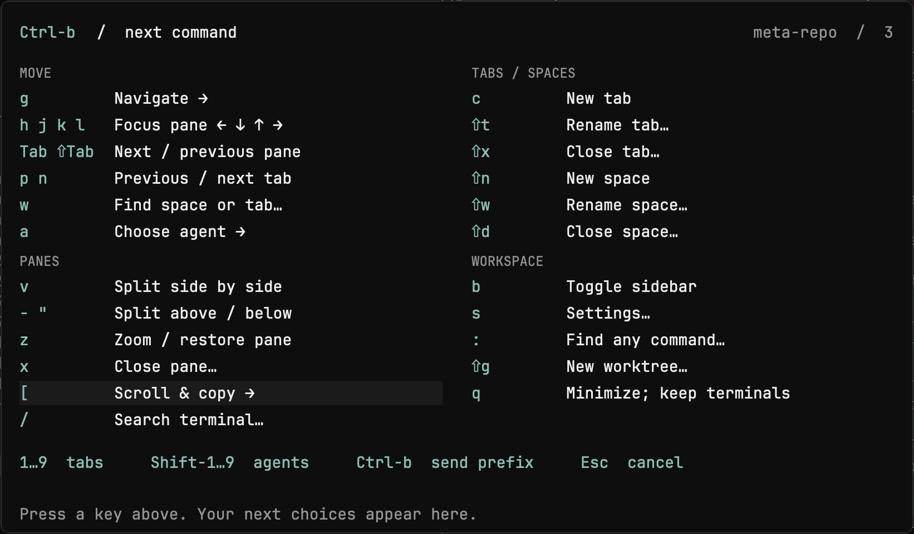

# Keyboard guide

A terminal-first command guide for Herdr app. Press **Ctrl-b** and choose
the next command from the live hints. It carries the Herdr TUI's navigation
and tmux's keyboard selection flow into the app, using your own theme.

## What you see

The main dialog is 820 × 480 logical pixels, centered in the window.
A header shows `Ctrl-b / next command` and the current space/tab.
Two columns list Move, Panes, Tabs / Spaces, and Workspace commands.
The main text is 14 px, with 12 px headings and 13 px search shortcuts.
Teal keys, white labels, muted headings and thin dividers come from the
host theme; this preview uses JetBrains Mono and a near-black background.
The footer shows numbered tabs, cancellation keys, and feedback for an
unrecognized or unavailable command. The copy popup is only 760 × 146 pixels,
centered in the window like the main guide, without dimming the terminal.

The optional `keyboard` layout keeps Herdr's standard spaces/sidebar,
tab bar, pane frames, panels and status information. Small teal numbers sit before
the tab icons; `⇧1…⇧9` sit before agent icons, including kept child agents.
The narrow agent sidebar shows the same badges. Numbers are shortcut hints,
not part of the tab or agent names. The status bar's **Ctrl-b commands**
button opens the same guide as the prefix key.

## How it behaves

The prefix captures the next key; unrelated input is not sent to the shell.
Known one-shot commands close the guide and act. `g` replaces the hint list
with persistent navigation controls, `a` lists numbered agents, `[` opens
the smaller scroll/copy popup. `w` searches spaces and tabs; `:` opens
the commands list immediately. Search for `help` and choose **More keys &
app limits** for the remaining keys and app limits inside the guide.
The header and available destinations follow live app state.

- **Move:** `h j k l` focus left/down/up/right. Tab and Shift-Tab cycle panes.
  In `g` mode, ↑/↓ switch spaces, `p/n` switch tabs, and `[/]` switch agents.
  Enter ends navigation; `1…9` select a tab and return immediately.
- **Panes:** `v` splits side by side; `-` or `"` splits above/below. `z`
  toggles zoom; `x` asks before closing.
- **Tabs:** `c` creates, `p/n` move, `1…9` select, `T` renames and `X` closes.
- **Spaces:** `N` creates, `W` renames, `D` closes, `w` searches spaces and
  tabs inside the guide, and `G` opens the native new-worktree dialog.
- **Agents:** Shift-1…9 selects from the exact list shown by `a`, following
  the numbered sidebar from top to bottom. Numbers update as rows move,
  are pinned or are folded. Visible kept children participate; repeated
  child rows and folded rows consume no extra number. Rows show the agent's
  working, blocked, idle, or done state as text. Beyond nine agents, use
  navigation mode's `[/]`. Without the numbered sidebar, the guide uses
  pins first, then space/tab order. Background children without panes are
  not numbered. Tab badges skip settled tabs and stop at nine.
- **Scroll and copy:** `[` enters copy mode. `h j k l` move its cursor;
  `v` anchors selection, `V` selects a line, and `y` or Enter copies.
  Ctrl-u/d move by a page, g/G go to the top/bottom, and 0/$ move to line
  edges. Escape or q clears the selection and leaves. Backspace returns
  to the full command guide. An existing selection is preserved on entry;
  `v` resets its anchor at the moving endpoint. Fast key sequences are
  processed in order. The underlying program receives no copy keys. Clicking
  outside cancels the popup instead of leaving an unfocused strip on screen.
- **Workspace:** `b` toggles the sidebar, `s` opens settings, `:` opens the
  guide's command search, `/` searches the terminal, and `q` minimizes the
  window while terminal programs keep running. Help is available by searching
  for `help` in the commands list.
- **Cancel/confirm:** Escape, Ctrl-[ or Ctrl-c leaves. Backspace goes back. Closing
  a pane/tab/space captures that target and asks for Enter/y; n returns.
  Ctrl-b a second time sends a literal Ctrl-b to the focused terminal.

In command or place search, type to filter, use ↑/↓ or Ctrl-p/n to choose,
and Enter to run. Ctrl-b returns to the main hints; Escape closes. Command
search includes pane swaps, moving tabs, pinning agents, layouts, themes,
zoom, updates and window controls. Close, reset, quit and update actions
explain their consequence before confirmation. Settings and name prompts
use native dialogs; search and help remain inside the guide.

Clicking a command row also runs it, but every command is keyboard reachable.
The dotfiles keymap makes Ctrl-b the only global Herdr shortcut, removing
competing entries such as Cmd-Shift-P, Cmd-/ and Cmd-t. Cmd-f becomes
Ctrl-b /. Terminal Cmd-a/c/v, Ctrl-v image paste, and text-editing bindings
remain available. Native text inputs retain macOS editing and clipboard
behavior. The app-owned macOS menu remains native; personal mods cannot
replace its menu commands.

## Built from

The guide uses Herdr's native mod runtime and your theme.
`layouts/keyboard.json` is a personal clone of Herdr 0.1.16's main layout.
Together with the guide, the package has four mods: `keyboard-tabs` and
`keyboard-agents` add shortcut badges to the corresponding shipped panels;
`keyboard-status` routes the footer's Commands button to the guide. They
retain native scrolling, menus, pinning, status groups, child trees, pane
actions and status information. The numbered panels read live data and use
the same target order as the guide; they do not rename anything. Their icons
come from Herdr's shipped mods. `layouts/keyboard.svg` previews the layout.

The original guide is covered by the package's root MIT `LICENSE`. The
cloned Herdr mods and layout retain Apache-2.0; the package includes the
unchanged upstream license at `upstream/LICENSE-herdr-app-0.1.16` and source,
version and change attribution in `upstream/README.md`. Keep those files
with redistributed copies; the MIT license does not relicense Herdr's code.

## Install

Use Herdr app **0.1.16 or newer**, with its matching generated APIs.

1. Copy `mods/keyboard-guide/` into `~/.config/herdr-app/mods/` (or your
   `HERDR_APP_HOME`). If that name exists, stop and reconcile your existing
   copy. Do not overwrite personal files or a redirected mod directory.
2. Back up your `keys.json`. Merge the package's `global.ctrl-b` binding
   into it; do not replace your entire keymap with this fragment. Resolve
   any existing Ctrl-b binding first. Ctrl-b ordinarily moves the shell
   cursor backward; after binding it, press Ctrl-b twice to send that key.
   For the same single-entry experience as dotfiles, keep only this binding
   in `global` and remove terminal Cmd-f. Preserve terminal clipboard,
   selection and text-editing bindings, and native input editing.
3. Run `herdr-app check ~/.config/herdr-app/mods/keyboard-guide`, inspect
   `herdr-app status`, and press Ctrl-b. Herdr reloads these files live.

For always-visible numbers and the Commands footer, also copy
`mods/keyboard-tabs/`, `mods/keyboard-agents/`, `mods/keyboard-status/`, and
`layouts/keyboard.{json,svg}` into the matching directories. Stop and reconcile
if any destination exists. Check all three extra mods with `herdr-app check`,
then select `herdr-app do layout.switch --name keyboard`.
Keep your previous layout; switch back to it to remove the numbered panels.

Use your existing theme. Leave shipped layouts/mods, settings and shared
state alone. An edited keymap is personal and no longer
receives upstream shortcut updates automatically.

To remove it, remove only the added Ctrl-b binding and this mod's folder,
or restore your keymap backup after accounting for later personal changes.
If you installed the numbered layout, switch to your previous layout before
removing its two files and the `keyboard-tabs`, `keyboard-agents` and
`keyboard-status` folders.
The dotfiles installer instead manages individual file links and backups.

## Watch out

- This is the desktop app's native mod, not the independent Herdr TUI.
- The TUI wins over conflicting tmux bindings: `b` toggles the sidebar and
  `%` remains Shift-5 for agent 5. `q` minimizes the window; it never kills
  terminals. In Herdr 0.1.16, `app.hide`, `app.hide_others` and `app.show_all`
  do nothing when dispatched from a mod, so the guide omits them and uses
  `window.minimize` for `q`.
- Keyboard pane resizing, pane renaming, and edit-scrollback have no app
  command. `r`, `P`, and `e` explain alternatives. `R` explains live reload.
- The optional panels are personal clones and do not receive upstream mod
  changes automatically. Reconcile those deliberately when upgrading Herdr.
- Herdr has no scrollback for alternate-screen programs such as Neovim;
  only their visible screen can be selected.
- Keep the source self-contained when using file symlinks: Herdr rejects
  relative JavaScript imports that escape the mod's real directory.
- With file symlinks, editing the target may not wake Herdr's watcher.
  `touch -h ~/.config/herdr-app/mods/keyboard-guide/main.js` refreshes the
  watched link; use your `HERDR_APP_HOME` when customized. Confirm live
  status after refreshing. Ordinary copied-file installations reload on save.
- Native `check` uses empty app data; passing it does not prove real
  keyboard delivery or selection behavior.

## Done when

- Native `herdr-app check` passes and the running app reports no errors.
- Ctrl-b opens the complete guide; g changes the hints; Escape returns
  typing to the original terminal. Unknown keys remain inside the guide.
- `:` opens commands directly; searching for `help` reaches the help
  page. `w` searches places. All stay inside the guide. Filtering, ↑/↓ or Ctrl-p/n,
  Enter and Ctrl-b work in both searches; confirmations name their effect.
- On a disposable tab, h/j/k/l select the expected panes; Tab cycles;
  v and - split in the named directions; x followed by n cancels closing.
- Tabs 1…9 and Shift-1…9 agents match the destinations described here.
- In the numbered layout, badges match those destinations after reordering
  tabs, pinning agents, changing statuses, and expanding kept child agents.
  The Ctrl-b commands footer opens the same guide.
- With known text in a disposable shell, `[` then h/j/k/l, v, motion, y
  copies exactly the selected text, including when entered quickly. Existing
  selections survive entry; Escape clears them and leaves the copy popup.
  Clicking outside also dismisses it and returns typing to the terminal.
  Copy keys never enter the shell.
- Ctrl-b Ctrl-b reaches the focused terminal; clipboard and text editing
  still work. With the single-entry keymap, competing global shortcuts no
  longer open a second command interface. `q` minimizes the window.
- Remove worktree search refuses the main checkout and unavailable Git
  folders; a linked worktree reaches the native dialog without removal
  during the read-only preflight.
- The full guide and copy strip are legible at the intended window size.

Before publishing, repeat these checks on the version you intend to support.
